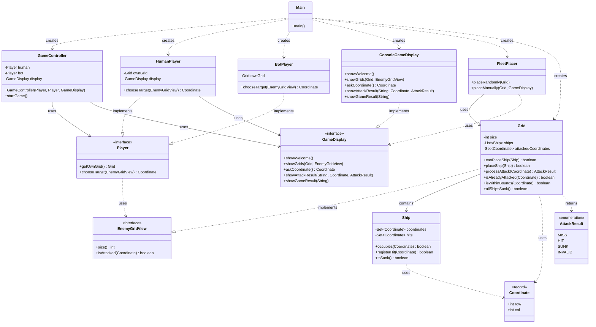

# Проєкт "Консольний Морський Бій"

Цей проєкт є простою реалізацією гри "Морський Бій" для одного гравця проти комп'ютера.

## 1. Вимоги (Проста Імплементація)

### 1.1. Загальні правила
* **Мета:** Першим знищити кораблі противника.
* **Гравці:** 1 Гравець (Людина) проти 1 Опонента (Комп'ютер).
* **Перемога:** Гравець перемагає, якщо знищив усі кораблі опонента.
* **Поразка:** Гравець програє, якщо усі його кораблі було знищено.
* **Хід гри:** Гравець та компʼютер ходять по черзі, обираючи координати для пострілу на полі суперника. Результати пострілів фіксуються на ігрових полях.

### 1.2. Ігрові сутності
* **Ігрове поле:** Сітка розміром `10x10` клітинок (рядки `1-10`, стовпці `A-J`), на якій розміщуються кораблі та фіксуються результати пострілів (промах, влучання, потоплення). Гравець не бачить розташування кораблів опонента на полі.
* **Кораблі:** Сутність на ігровому полі, яка займає одну або декілька суміжних клітинок (горизонтально чи вертикально) на ігровому полі і має певну довжину.
* **Склад флоту (10 кораблів на кожного гравця):**
  * 1 лінкор - корабель довжиною 4 клітинки.
  * 2 крейсери - корабель довжиною 3 клітинки.
  * 3 есмінці - корабель довжиною 2 клітинки.
  * 4 катери - корабель довжиною 1 клітинку.
* **Знищення корабля:** Корабель вважається знищеним, якщо всі його клітинки отримали влучання.
* **Гравець:** Сутність, що володіє власним ігровим полем, флотом кораблів та обирає координати для пострілу.

### 1.3. Ігровий процес
1. Гра починається. Створюються два поля та набори кораблів для гравця і компʼютера.
2. **Розміщення кораблів:**
   - Кораблі не можуть виходити за межі поля, перетинатися або торкатися кутами/сторонами одне з одним.
   - Гравець розміщує кораблі на своєму полі вручну або автоматично, компʼютер - автоматично.
3. **Хід Гравця:**
   - Гравець бачить своє поле та поле опонента (без видимих кораблів опонента).
   - Гравець вводить координати пострілу (наприклад, "A1", "B5").
   - Система перевіряє постріл:
     - **Промах:** Клітинка відмічається як промах. Хід переходить опоненту.
     - **Влучання або Потоплення:** Клітинка відмічається як влучання. Якщо це остання клітинка корабля, то корабель вважається знищеним. Гравець отримує право на повторний постріл, доки не промахнеться або не знищіть усі кораблі опонента.
4. **Хід Компʼютера:**
   - Компʼютер випадково обирає ще не атаковану клітинку на полі гравця та виконує постріл.
   - Правила ходів такі самі, як і у гравця.
5. **Визначення переможця:**
   - Гра закінчується, коли всі кораблі одного з гравців будуть знищені. Виводиться результат партії.

### 1.4. Поза скоупом (Scope):
У цій простій імплементації **ВІДСУТНІ**:
- Мультиплеєр та мережева гра.
- Збереження / завантаження / перегляд історії партій.
- Додаткові режими/здібності (додаткові поля/мапи, міни, залпи, літаки).
- Розумний ШІ (компʼютер стріляє виключно випадково).

---
## 2. Дизайн Системи (Проєктування)

Система буде побудована на принципах SOLID та DIP, щоб розділити відповідальності та забезпечити гнучкість.

### 2.1. Архітектурні принципи
* **SRP (Single Responsibility):** Логіка розділена на компоненти: `Grid` (керує ігровим полем), `Ship` (керує кораблем), `Player` (керує гравцем), `GameDisplay` (керує вводом/виводом), `GameController` (керує грою).
* **DIP (Dependency Inversion):** `GameController` (високорівневий модуль) не залежатиме від `HumanPlayer`, `BotPlayer`, `ConsoleGameDisplay` (низькорівневі модулі), а від їхніх абстракцій (`Player`, `GameDisplay`).

### 2.2. Компоненти (Інтерфейси та Класи)
- `model.Coordinate`(record): Представляє координату на полі (`row`,`col`).
- `model.AttackResult`(enum): Перелік результатів атаки (`HIT`, `MISS`, `SUNK`, `INVALID`).
- `model.Ship`: Представляє корабель на полі (`Set<Coordinate> coordinates`, `Set<Coordinate> hits`, `occupies(...)`, `registerHit(...)`, `isSunk()`).
- `model.Grid`: Представляє ігрове поле розміром `10x10`. Перевіряє правильність розміщення корабля та додає його (`canPlaceShip(Ship)`,`placeShip(Ship)`), обробляє атаку (`processAttack(...)`) та перевіряє, чи знищено весь флот (`allShipsSunk()`).
- `service.FleetPlacer`: Розміщує флот на полі автоматично або вручну через консоль
- `interfaces.EnemyGridView`: Інтерфейс безпечного перегляду поля опонента без видимості не знищених кораблів.
- `interfaces.Player`: Інтерфейс для гравця.
  - `chooseTarget(EnemyGridView enemyView)` - обирає координату для атаки на основі перегляду поля суперника.
- `service.HumanPlayer`(implements `Player`): Реалізація, що питає хід у консолі.
- `service.BotPlayer`(implements `Player`): Реалізація ШІ.
- `interfaces.GameDisplay`: Інтерфейс для вводу/виводу.
  - `showWelcome()`, `showGrids(...)`, `askCoordinate()`, `showAttackResult(...)`, `showGameResult(...)`
- `service.ConsoleGameDisplay`(implements `GameDisplay`): Реалізація вводу/виводу у консолі.
- `GameController`: Головний клас, що керує грою. Отримує всі залежності через конструктор.

### 2.3. UML-діаграма (спрощена)

